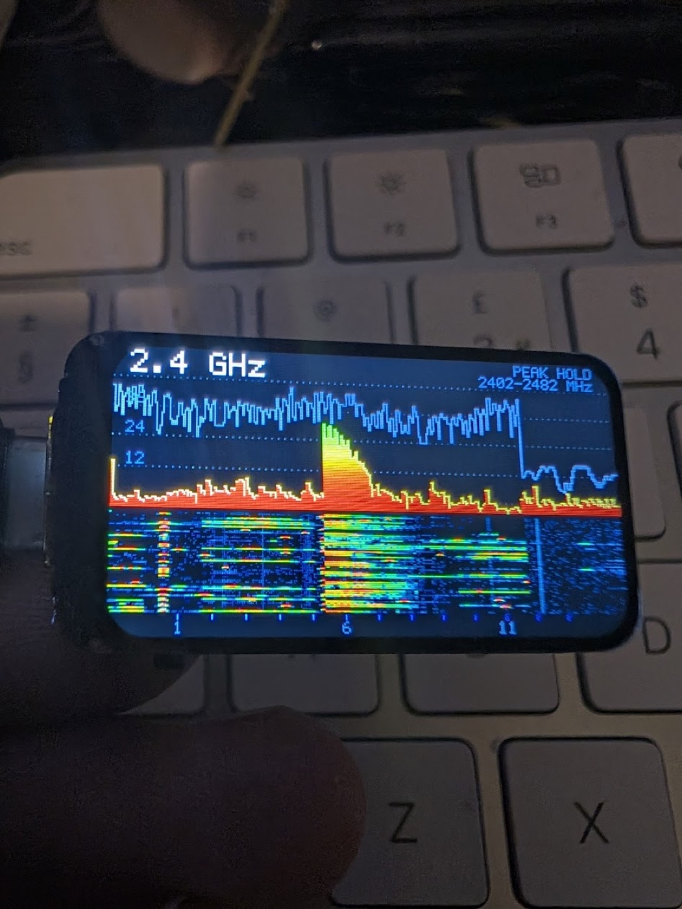
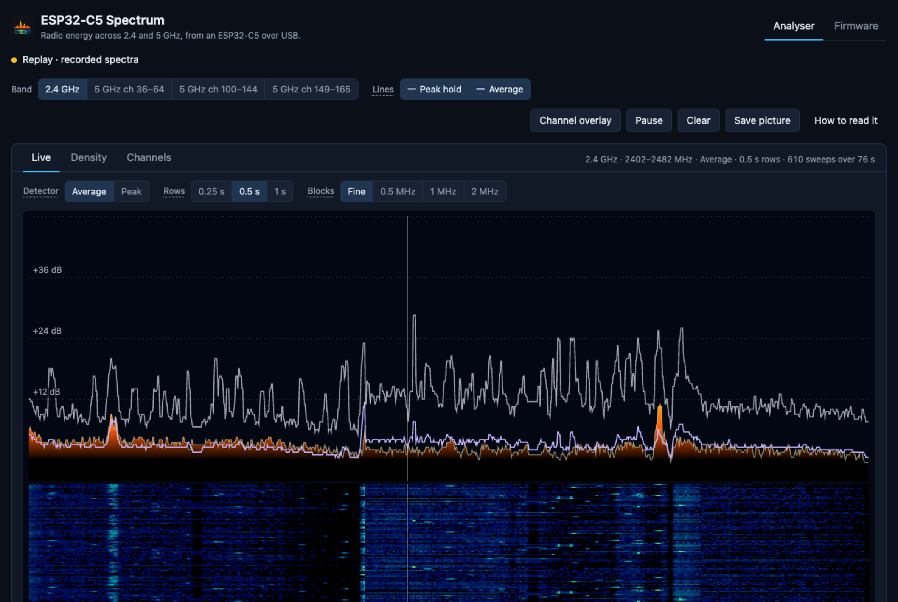
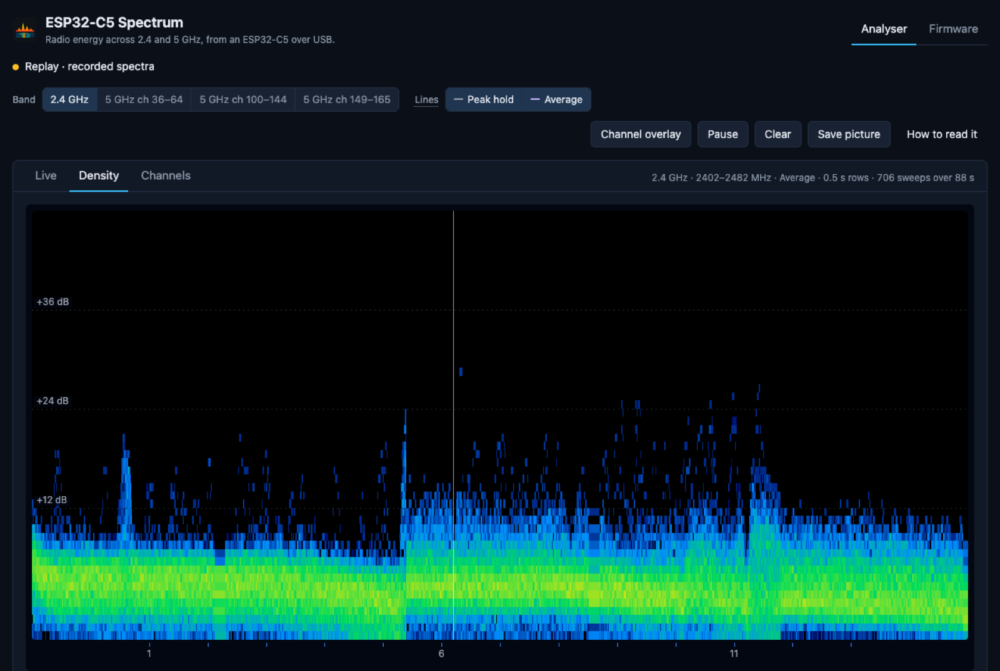
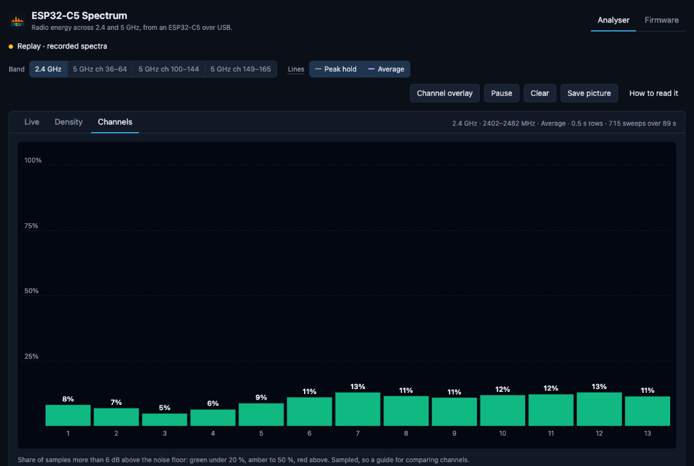

  

<h1 align="center">esp32c5-spectrum</h1>

  <b>A Wi-Fi spectrum analyser for the price of a pizza.</b> 
  An ESP32-C5 dev board, its own little screen, 2.4 and 5 GHz. That's the whole bill of materials.

  <a href="https://jamesjulier.github.io/esp32c5-spectrum/"><b>Open the app</b></a> ·
  <a href="https://jamesjulier.github.io/esp32c5-spectrum/#firmware"><b>Flash a board</b></a> ·
  <a href="#how-to-use-it">How to use it</a> ·
  <a href="docs/technical.md">Technical notes</a>

  
  
  
  

  

## What is it?

Your Wi-Fi scanner tells you which networks are around. It doesn't tell you about the microwave
in the kitchen, the video sender in the corner, or the cheap camera hammering channel 6. This does.

It shows **all** the radio energy across 2.4 and 5 GHz, Wi-Fi or not, with the Wi-Fi channels
marked underneath, so you can see what's actually sharing the air with your network.

A proper spectrum analyser costs hundreds. This one runs on a dev board you can buy with change
from a twenty, and the clever bit isn't mine: [ESP-SDR](https://github.com/ESPARGOS/esp-sdr) by
Florian Euchner worked out how to read raw samples from the ESP32-C5's own Wi-Fi receiver. I
gave it a screen, buttons and a browser app.

Plug it into a USB charger and it just runs, no laptop needed. Plug it into a laptop instead and
you get a bigger picture, with views that show how busy each channel really is. Flashing it
happens in the same web page, so there's nothing to install.

## How to use it

You'll need one of the [supported boards](#supported-boards), a USB-C cable, and Chrome or Edge
on a computer (Mac, Windows, Linux or a Chromebook). Once it's flashed, the analyser also works in
Chrome on an Android phone.

### 1. Put the firmware on it (once)

1. Open **https://jamesjulier.github.io/esp32c5-spectrum/** and go to the **Firmware** tab.
2. Pick your board, plug it in and click **Connect board**. In Chrome's list, choose
   **USB JTAG/serial debug unit**.
3. Click **Flash**. Half a minute later it's done, and the board's screen comes to life.

### 2. Use it on its own

Give it power from any USB port or power bank and it starts measuring.

| BOOT button | What it does |
|---|---|
| Press | Next band: 2.4 GHz, then three ranges of 5 GHz |
| Double press | Peak hold on or off |

The 2.8" touch board does more: swipe between bands, tap to read a frequency, tap a channel
number to zoom in ([all the gestures](#touch-on-the-28-board)).

### 3. Or plug it into your computer or Android phone

1. Open the app's **Analyser** tab and click **Connect board**.
2. The board's screen says **PHONE CONNECTED** while the app has the radio. It goes back to
   its own display 10 seconds after you close the app.
3. Pick a band and hover over the chart to read the frequency, nearest channel and level.

Want it as a proper app? Click **Install** at the right-hand end of Chrome's address bar. You get
an icon and its own window, and it works offline.

## What you're looking at

  

- **The trace** is the level right now: red at the noise floor, green on strong signals. Wi-Fi
  shows up as a hump about 20 MHz wide. A narrow spike is usually something that isn't Wi-Fi.
- **The grey line** is peak hold, the highest level seen so far.
- **The waterfall** is history, newest at the top. Solid colour is something that never stops,
  flecks are bursts of traffic.

| **Density**: how often each level turns up | **Channels**: how busy each Wi-Fi channel is |
|---|---|
|  |  |

The lowest bar on **Channels** is your quietest channel. That's usually the one to pick.

Levels are in **dB above the noise floor**, not dBm. The receiver's gain isn't calibrated, so the
numbers are good for comparing signals, not for measuring exactly how strong they are.

## Supported boards

| Board | Screen | Best for |
|---|---|---|
| **Waveshare ESP32-C5-LCD-1.47** | 320 × 172, read sideways | A pocket analyser with one button |
| **Waveshare ESP32-C5-Touch-LCD-2.8** | 240 × 320, touch | The full version: touch, zoom, channel scorecard, battery |
| **LilyGO T-Dongle-C5** | 160 × 80, read sideways | A USB stick that lives in your laptop |
| **Seeed XIAO ESP32-C5** | none | The cheapest way in, for use with the browser app |

### Touch on the 2.8" board

| Gesture | What it does |
|---|---|
| Swipe left or right | Next or previous band |
| Tap the chart | Read the frequency, channel and level, for example "2437 MHz · ch 6 · +24 dB" |
| Tap the header | Show or hide the Wi-Fi channel outlines |
| Tap a channel number | Zoom to that channel, and tap again to zoom out |
| Double tap | Peak hold on or off |
| Hold for a second | Freeze the picture |

A scorecard under the channel numbers colours each channel by how busy it was over the last
minute and names the quietest one.

## Worth knowing

It only listens. Nothing is transmitted once it's running, though the radio chip may make a tiny
calibration blip as it powers up.

It works in snapshots, about 285 a second with short gaps between them, so a very brief burst can
slip past unseen.

The browser app needs Chrome or Edge on a computer, or Chrome on Android with the board plugged
into the phone (USB-C to USB-C). Flashing needs a computer. Safari, Firefox and iPhones can't talk
to USB devices, so they're out. The board on its own is happy with any USB power.

There are two easter eggs in the app. One of them involves your microwave.

## Build it yourself

Everything's here: the firmware patch and screen code in `firmware/`, the browser app in `web/`.
How to build it, how the measuring works, board pin-outs and the panel quirks I found along the
way are in **[docs/technical.md](docs/technical.md)**.

## Credits

Made by **[JJ](https://github.com/jamesjulier)** (James Julier, [LinkedIn](https://www.linkedin.com/in/james-alexander-julier-2137844/)). Issues, ideas and photos of it
finding something odd in your house are all welcome.
 

- **[ESP-SDR](https://github.com/ESPARGOS/esp-sdr) by Florian Euchner (ESPARGOS)** does the hard
  part, the radio. This project is a modified version of it: my changes are the patch in
  `firmware/patches/` (each file it touches says "Modified by James Julier, 2026") and the screen
  code in `firmware/components/`. A copy of the exact ESP-SDR version used is kept at
  [jamesjulier/esp-sdr](https://github.com/jamesjulier/esp-sdr/tree/esp32c5-spectrum-base).
- **Espressif** for ESP-IDF, esp-dsp and esptool-js.
- **LovyanGFX**, **LilyGO** and **Waveshare**, whose published panel settings, pin maps and touch
  protocol saved a lot of squinting at datasheets.
- **[Inter](https://github.com/rsms/inter)** and **[Manrope](https://github.com/sharanda/manrope)**,
  the fonts on the board's screen (`FONTS-LICENCE.md`).

## Licence

Copyright © 2026 James Julier. Licensed under **GPL-3.0** (`LICENSE`), the same as ESP-SDR.
Every third-party part and its licence is listed in [THIRD-PARTY-NOTICES.md](THIRD-PARTY-NOTICES.md).
If you're given a board running this firmware, you're entitled to its source: this repository
plus ESP-SDR at the commit named in `web/public/firmware/manifest.json`.

Found a security problem? Please see [SECURITY.md](SECURITY.md).
